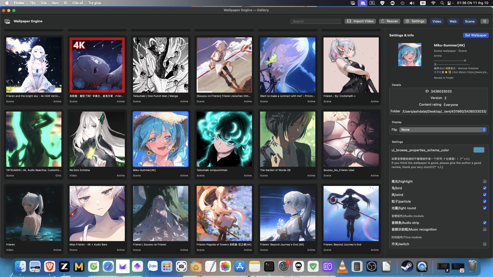

<div align="center">


# Wallpaper Engine for macOS

**A native macOS application to run Steam Wallpaper Engine wallpapers directly on your desktop.**

[](https://www.apple.com/macos/)
[]()
[](LICENSE)
[](https://github.com/ashdalat/WallpaperEngine-for-Mac/releases)

[Download Prebuilt App](https://github.com/ashdalat/WallpaperEngine-for-Mac/releases/latest) • [Features](#-features) • [Installation](#-installation) • [Build from Source](#-build-from-source) • [Credits](#-credits--acknowledgements)

<br/>



</div>


---

## 🌟 Overview

**Wallpaper Engine for macOS** is a lightweight, high-performance native macOS agent app (Swift / AppKit / SwiftUI + Metal/MoltenVK C++ backend) that brings your **Steam Wallpaper Engine** (AppID `431960`) collection to macOS.

No Windows virtualization, no Wine/Proton layers, and no Steam runtime client required at runtime.

- **Native performance:** Hardware-accelerated decoding via VideoToolbox and 3D Vulkan scene rendering translated directly to Metal via MoltenVK.
- **Steam integration:** Reads wallpapers directly from your local Steam library (`steamapps/workshop/content/431960/`).
- **Agent app (`LSUIElement`):** Sits discreetly in your menu bar without cluttering the Dock.

---

## 🚀 Features

| Feature | Description |
|---|---|
| 🎬 **Video Wallpapers** | Hardware-accelerated H.264 & HEVC decode (VideoToolbox), volume & mute control, seamless looping. |
| 🌐 **Web Wallpapers** | WKWebView engine with full Wallpaper Engine JavaScript bridge (`wallpaperPropertyListener`, custom user properties, mouse event forwarding). |
| 🎮 **3D Scene Wallpapers** | Native C++ rendering engine (`open-wallpaper-engine`) translated from Vulkan to Metal via MoltenVK, parsing `scene.pkg` (MDL models, puppets, textures, animations). |
| 🖥️ **Multi-Monitor Support** | Independent wallpaper management across multiple displays with distinct resolutions. |
| ⏸️ **Smart Pause** | Automatically pause wallpapers when apps are fullscreen, maximized, focused, on battery power, or when the screen is locked/asleep. |
| 🎛️ **Live Customization** | Dynamic per-wallpaper settings (sliders, color pickers, combos, checkboxes) plus live display controls (Flip Horizontal / Vertical). |
| 🖼️ **Interactive Gallery** | Modern SwiftUI gallery with search, type filters, live preview window, and context actions. |
| 🚀 **Launch at Login** | Seamless startup with macOS via `SMAppService` (Login Items). |
| 📦 **Self-Contained** | Pre-bundled libraries (MoltenVK, FFmpeg, lz4, fontconfig, freetype) — runs out of the box without Homebrew! |

---

## 📥 Installation

### Method 1: Prebuilt App (Recommended)

1. Download the latest release: **[WallpaperEngineMac-v1.0.0-macOS.zip](https://github.com/ashdalat/WallpaperEngine-for-Mac/releases/latest)**.
2. Unzip and drag `WallpaperEngineMac.app` into your `/Applications` folder.
3. **First Launch (Gatekeeper):**
   - Right-click (or Control-click) `WallpaperEngineMac.app` → select **Open** → click **Open** to confirm.
   *(This is standard for ad-hoc signed open-source macOS software without an Apple Developer subscription).*
4. **Permissions:**
   - For interactive web wallpapers with mouse tracking, grant **Accessibility** access when prompted in *System Settings → Privacy & Security → Accessibility*.

---

## 🛠️ Build from Source

### Prerequisites
Ensure you have Xcode Command Line Tools and Homebrew installed:

```bash
xcode-select --install
brew install molten-vk ffmpeg lz4 fontconfig freetype llvm glslang
```

### Compile & Install
```bash
git clone https://github.com/ashdalat/WallpaperEngine-for-Mac.git
cd WallpaperEngine-for-Mac

# 1. Build Scene Backend (MoltenVK Vulkan bridge)
bash scene_backend_new/BuildSceneBackend.sh

# 2. Build and bundle the macOS Application
bash build_app_manual.sh

# 3. Install to Applications
codesign --force --sign - build_manual/WallpaperEngineMac.app
cp -R build_manual/WallpaperEngineMac.app /Applications/
```

---

## 📖 Usage Guide

- **Menu Bar Icon:** Click the menu bar icon to toggle playback, change pause modes, adjust audio volume, or open the Wallpaper Gallery.
- **Choosing Steam Library:** If your gallery is empty on first launch, click **Settings...** and select your Steam directory containing `steamapps/workshop/content/431960/`.
- **Wallpaper Settings:** Right-click any wallpaper card in the gallery and click **Settings & Info...** to tune color schemes, frame rates, and custom options.

---

## 💡 Credits & Acknowledgements

This project was made possible by referencing and standing upon the shoulders of amazing open-source projects:

- **[Waywallen](https://github.com/waywallen/waywallen)**: Inspiration for multi-monitor management architecture, smart pause policies, and display transformations.
- **[open-wallpaper-engine / linux-wallpaperengine](https://github.com/Almamu/linux-wallpaperengine)**: The core C++ Vulkan scene rendering backend and asset parser for `scene.pkg`.
- **Steam Wallpaper Engine**: Created and owned by Kristjan Skutta. This project is an independent community client and is not affiliated with or endorsed by Valve or Kristjan Skutta.

---

## 📜 License

Distributed under the **GNU General Public License v3.0 (GPLv3)**. See [LICENSE](LICENSE) for more details.
